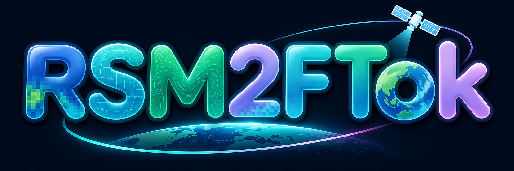
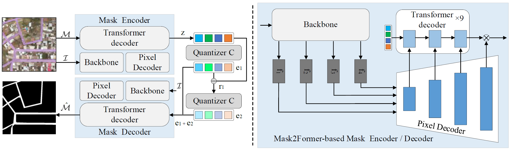

<p align="center">
  
</p>

<h2 align="center">From Masks to Language: A Remote Sensing Mask Tokenizer for Pixel-wise Earth Observation Foundation Models</h2>

<p align="center">
  <a href="https://github.com/koreyoshieo/RSM2FTok"></a>
  <a href="https://huggingface.co/koreyoshieo/RSM2FTok"></a>
</p>

<p align="center">
  <a>Yujie Zan</a><sup>a</sup>, <a>Yikang Zhou</a><sup>a</sup>, <a>Tao Zhang</a><sup>a</sup>, <a>Dengxian Gong</a><sup>a</sup>, <a>Muying Luo</a><sup>b</sup>, <a>Wenling Yu</a><sup>c</sup>, <a>Kourosh Khoshelham</a><sup>d</sup>, <a>Shunping Ji</a><sup>a,*</sup>
  <p align="center"><sup>a</sup>School of Remote Sensing and Information Engineering, Wuhan University, Wuhan 430079, China<br><sup>b</sup>School of Electrical Engineering, Guangxi University, Nanning 530004, China<br><sup>c</sup>School of Mechanical and Electrical Engineering, Jingdezhen Ceramic University, Jingdezhen 333403, China<br><sup>d</sup>Department of Infrastructure Engineering, The University of Melbourne, Parkville, VIC 3010, Australia</p>
</p>

<p align="center"></p>
<p align="center">The architecture of the proposed RSM2FTok.</p>

## Opensource progress

- ⏳ Release model weights.
- ⏳ Release TokLLM evaluation codes.
- ⏳ Release Gradio demo codes.
- ⏳ Release tokenizer training codes.
- ⏳ Release TokLLM training codes.
- ⏳ Release RL codes.

## Model Zoo

| Model | Checkpoint | Description |
|:-:|:-:|:-:|
| Qwen3-VL-2B-Tok | [Link]() | Jointly trained on 15 remote-sensing segmentation datasets and the RefCOCO family. |
| Qwen2.5-VL-3B-Tok | [Link]() | Jointly trained on 15 remote-sensing segmentation datasets and the RefCOCO family. |
| Qwen3-VL-2B-Tok-rl | [Link]() | Further GRPO-trained from Qwen3-VL-2B-Tok on mask generation; recommended for segmentation. |
| Qwen2.5-VL-3B-Tok-rl | [Link]() | Further GRPO-trained from Qwen2.5-VL-3B-Tok on mask generation; recommended for segmentation. |
| Qwen3-VL-2B-Tok-cd | [Link]() | Further mixed training on change detection and landslide mapping. |
| Qwen3-VL-2B-Tok-cd-rl | [Link]() | Further GRPO-trained from Qwen3-VL-2B-Tok-cd; recommended for change detection. |

The released tokenizer checkpoint is available at [koreyoshieo/RSM2FTok](https://huggingface.co/koreyoshieo/RSM2FTok).

## Environment

```bash
curl -LsSf https://astral.sh/uv/install.sh | sh
uv sync --extra=vlm --extra=tokenizer
source .venv/bin/activate

git clone https://github.com/facebookresearch/detectron2.git detectron2
uv pip install -e detectron2 --no-build-isolation

cd mask2former/modeling/pixel_decoder/ops
sh make.sh
cd ../../../..
```

## Training

Please refer to [TRAIN_TOKENIZER.md](projects/rsm2ftok/docs/TRAIN_TOKENIZER.md) for tokenizer training.

Please refer to [TRAIN_VLM.md](projects/rsm2ftok/docs/TRAIN_VLM.md) for TokLLM training.

We implement the RL code based on [Easy-R1](https://github.com/hiyouga/EasyR1), with the only modification lying in the reward design. Please refer to `rl/reward_function/text2mask_seg_16tk.py` for details. The RL launch script will be provided with the RL release.

## Acknowledgement

Thanks for the following awesome works:

- [SAMTok](https://github.com/bytedance/Sa2VA/tree/main/projects/samtok)
- [Sa2VA](https://github.com/bytedance/Sa2VA)
- [Mask2Former](https://github.com/facebookresearch/Mask2Former)

This project builds upon and adapts code from these works.

## Citation

The paper is currently under preparation. Citation information will be added after publication.
