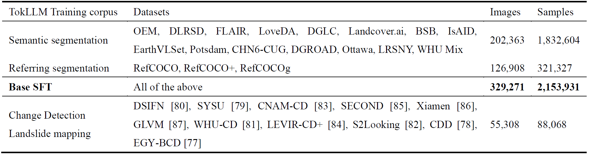

# Train TokLLM

This document describes the TokLLM data preparation and training workflow for Qwen3-VL and Qwen2.5-VL.

## Dataset Preparation

Our TokLLM training corpus covers semantic segmentation, referring segmentation, change detection, and landslide mapping. The dataset composition is summarized below.

<p align="center"></p>

### Tokenizing 2D masks

The following scripts show the format used to convert remote-sensing masks into RSM2FTok mask-token conversations:

- Semantic segmentation (BSB example): [tokenize_rssem_256x2.py](../datasets/tokenize_2d_mask/tokenize_rssem_256x2.py)
- Change and semantic change detection (SECOND example): [tokenize_rs_scd_256x2.py](../datasets/tokenize_2d_mask/tokenize_rs_scd_256x2.py)

### Convert to conversations

All mask-related datasets should be converted to a unified VQA format. Each sample contains an image and a human/assistant conversation. A 2D mask is represented by `<|mt_start|>`, 32 mask tokens, and `<|mt_end|>`. The following is one example; a JSON file for training and debugging will be provided here: [TokLLM conversation data](#).

```json
{
  "image": "Ottawa/ottawa/train/image/ottawa_7_7.png",
  "conversations": [
    {
      "from": "human",
      "value": "<image>\nWhat category does the region <|mt_start|><|mt_0238|><|mt_0310|><|mt_0097|><|mt_0288|><|mt_0083|><|mt_0334|><|mt_0210|><|mt_0385|><|mt_0038|><|mt_0401|><|mt_0122|><|mt_0495|><|mt_0167|><|mt_0441|><|mt_0061|><|mt_0508|><|mt_0003|><|mt_0442|><|mt_0031|><|mt_0317|><|mt_0241|><|mt_0317|><|mt_0030|><|mt_0500|><|mt_0109|><|mt_0411|><|mt_0038|><|mt_0418|><|mt_0099|><|mt_0397|><|mt_0193|><|mt_0430|><|mt_end|> belong to?"
    },
    {
      "from": "gpt",
      "value": "road"
    }
  ]
}
```

## Training

### Adding new tokens

Run [add_special_tokens.py](../utils/add_special_tokens.py) once for the selected Qwen-VL base model before training.

### Training with Xtuner

Two example configurations:

- Qwen3-VL: [qwen3vl_2b_full_mt256x2.py](../configs/qwen3vl_2b_full_mt256x2.py)
- Qwen2.5-VL: [qwen25vl_3b_full_mt256x2.py](../configs/qwen25vl_3b_full_mt256x2.py)

Launch Qwen3-VL training with:

```bash
bash tools/dist.sh train projects/rsm2ftok/configs/qwen3vl_2b_full_mt256x2.py 2 --deepspeed deepspeed_zero2
```

Launch Qwen2.5-VL training with:

```bash
bash tools/dist.sh train projects/rsm2ftok/configs/qwen25vl_3b_full_mt256x2.py 2 --deepspeed deepspeed_zero2
```
